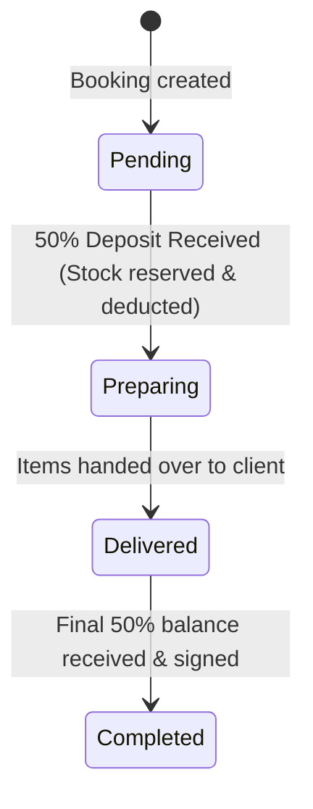

# Saint Paul Scouts (TsPs) Warehouse — Quotation & Booking System Specification

## 1. Executive Summary & Brand Identity
- **Organization**: Saint Paul Scouts (مجموعة القديس بولس الكشفية - TsPs)
- **Division**: Apparel & Uniform Supply Department
- **Official Contact Phone**: `01212101148`
- **Official Contact Email**: `spsstore35@gmail.com`
- **Currency Standard**: All monetary values, unit rates, discounts, deposit quotas, and remaining balances are denominated strictly in **Egyptian Pounds (EGP)**.

---

## 2. Terminology & UI Standards
Following the latest warehouse standardization:
- **Item Model**: Replaces legacy "Garment Model" to accommodate all uniforms, scout accessories, badges, and apparel.
- **Item Name**: Standardized product title (e.g., *Chemise Kashafa*, *T-Shirt Class B*).
- **Item Description**: Clear specifications, fabric composition, and scout usage context.
- **Color & Size Matrix**: Distinct circular color swatches with individual size chips displaying live warehouse quantities.
- **Initial Quantity State**: Default order quantity input starts blank (`""`) to ensure intentional count entry without accidental pre-filled quantities.

---

## 3. Quotation Numbering Logic
Quotations follow a deterministic daily sequence format:
```text
SPS-[Day]-[Month]-[Year]-[DailySequenceNumber]
```
### Examples:
- First quotation on October 31, 2026: `SPS-31-10-2026-1`
- Second quotation on the same date: `SPS-31-10-2026-2`
- Next quotation on November 1, 2026: `SPS-01-11-2026-1`

---

## 4. 50% Mandatory Advance Deposit Workflow

### Order Lifecycle Stages


1. **Pending Status (Quotation Stage)**:
   - Client places order for any item and quantity, even if out of stock or exceeding warehouse quantities.
   - **Warehouse stock is NOT deducted** while in Pending status.
   - Yellow **Stock Rule Note** informs staff that stock remains untouched.
   - Official Printable Quotation is generated for the client with the 50% deposit requirement clearly itemized.

2. **Preparing Status (Workshop Production & Packing)**:
   - Triggered when the mandatory **50% advance deposit** is confirmed.
   - Available warehouse units are immediately deducted.
   - Deficit quantities (order quantity minus available warehouse stock) are assigned to the workshop tailoring division.
   - Recommended production automatically accounts for safety stock thresholds.

3. **Delivered Status**:
   - Items dispatched and handed over to the client representative against signature.

4. **Completed Status**:
   - Remaining 50% balance collected and cleared.

---

## 5. Printable Document Formats (A4 Standard)

### A. Client Quotation (`BookingPrintModal.tsx`)
- **Header**: Clean typographic identity for *Saint Paul Scouts Warehouse* with official phone (`01212101148`) and email (`spsstore35@gmail.com`).
- **Table Columns**:
  1. `#` (Index)
  2. `Item Description` (Item name)
  3. `Color` (Visual swatch + color title)
  4. `Size` (Textile sizing code)
  5. `Qty` (Client requested quantity)
  6. `Unit Price (EGP)`
  7. `Line Total (EGP)`
  *(SKU column has been intentionally excluded for simplified client readability).*
- **Financial Breakdown**:
  - Gross Subtotal (EGP)
  - Order Discount (if applied)
  - **Total Order Value (EGP)**
  - **50% Required Advance Deposit (EGP)**
  - **50% Balance Due on Handover (EGP)**
- **Official Policy Statement**: Work commencement, stock reservation, and workshop production will NOT begin until the mandatory 50% advance deposit is received and verified.
- **Signatures**: Client Acceptance Signature and Saint Paul Scouts Authorized Warehouse Stamp.

### B. Workshop Production & Deficit Sheet
- Tailored for the cutting and manufacturing division.
- Lists warehouse stock, client requested units, and calculated **DEFICIT TO PRODUCE**.
- Highlights minimum safety thresholds and recommended batch quantities.

---

## 6. Database Schema & RLS Architecture (PostgreSQL / Supabase)

```sql
-- 1. Bookings Master Table
CREATE TABLE IF NOT EXISTS public.bookings (
  id TEXT PRIMARY KEY,
  booking_number TEXT NOT NULL UNIQUE,
  client_name TEXT NOT NULL,
  client_phone TEXT NOT NULL,
  notes TEXT,
  status TEXT NOT NULL DEFAULT 'pending' CHECK (status IN ('pending', 'preparing', 'delivered', 'completed', 'cancelled')),
  subtotal NUMERIC(12, 2) NOT NULL DEFAULT 0,
  discount NUMERIC(12, 2) NOT NULL DEFAULT 0,
  total NUMERIC(12, 2) NOT NULL DEFAULT 0,
  deposit_required NUMERIC(12, 2) NOT NULL DEFAULT 0,
  deposit_paid BOOLEAN NOT NULL DEFAULT FALSE,
  created_by_id TEXT,
  created_by_name TEXT,
  created_by_role TEXT,
  created_at TIMESTAMPTZ NOT NULL DEFAULT timezone('utc'::text, now()),
  updated_at TIMESTAMPTZ NOT NULL DEFAULT timezone('utc'::text, now())
);

-- 2. Booking Line Items Table
CREATE TABLE IF NOT EXISTS public.booking_items (
  id TEXT PRIMARY KEY,
  booking_id TEXT NOT NULL REFERENCES public.bookings(id) ON DELETE CASCADE,
  product_id TEXT NOT NULL,
  product_name TEXT NOT NULL,
  product_sku TEXT,
  product_image TEXT,
  variant_id TEXT NOT NULL,
  size TEXT NOT NULL,
  color_name TEXT NOT NULL,
  color_hex TEXT NOT NULL,
  quantity INTEGER NOT NULL CHECK (quantity > 0),
  unit_price NUMERIC(12, 2) NOT NULL DEFAULT 0,
  total_price NUMERIC(12, 2) NOT NULL DEFAULT 0,
  available_stock INTEGER NOT NULL DEFAULT 0,
  deficit_quantity INTEGER NOT NULL DEFAULT 0,
  min_threshold INTEGER NOT NULL DEFAULT 5,
  recommended_production INTEGER NOT NULL DEFAULT 0,
  created_at TIMESTAMPTZ NOT NULL DEFAULT timezone('utc'::text, now())
);

-- Indexes for high-throughput searching
CREATE INDEX IF NOT EXISTS idx_bookings_status ON public.bookings(status);
CREATE INDEX IF NOT EXISTS idx_bookings_created_at ON public.bookings(created_at DESC);
CREATE INDEX IF NOT EXISTS idx_booking_items_booking_id ON public.booking_items(booking_id);

-- Row Level Security (RLS)
ALTER TABLE public.bookings ENABLE ROW LEVEL SECURITY;
ALTER TABLE public.booking_items ENABLE ROW LEVEL SECURITY;

-- Allow authenticated and warehouse staff to read & manage bookings
CREATE POLICY "Allow warehouse staff to read bookings"
ON public.bookings FOR SELECT
USING (true);

CREATE POLICY "Allow warehouse staff to insert bookings"
ON public.bookings FOR INSERT
WITH CHECK (true);

CREATE POLICY "Allow warehouse staff to update bookings"
ON public.bookings FOR UPDATE
USING (true);

CREATE POLICY "Allow warehouse staff to delete bookings"
ON public.bookings FOR DELETE
USING (true);

CREATE POLICY "Allow warehouse staff to manage booking items"
ON public.booking_items FOR ALL
USING (true);
```
